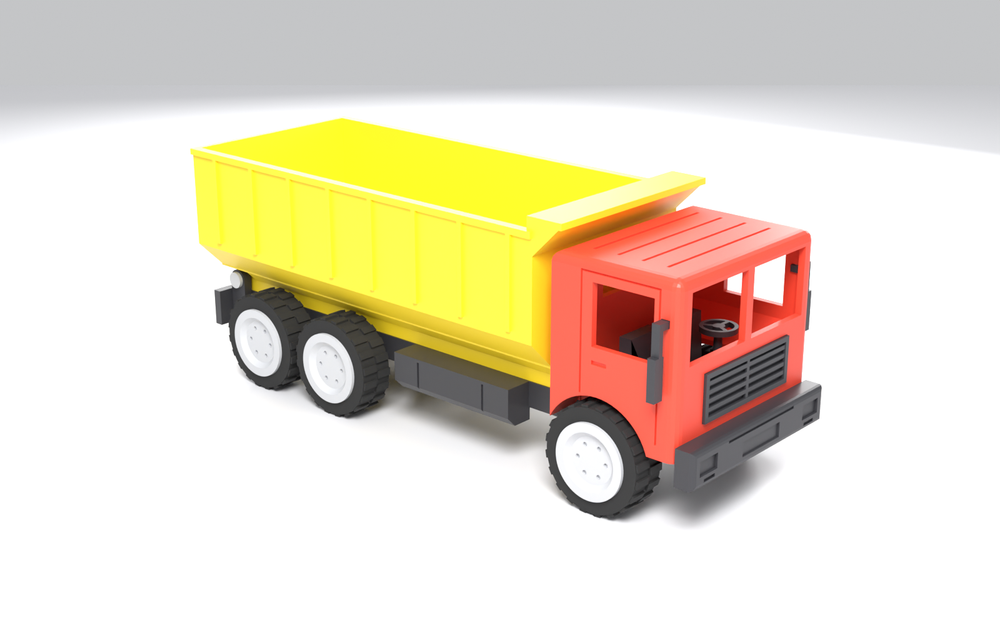
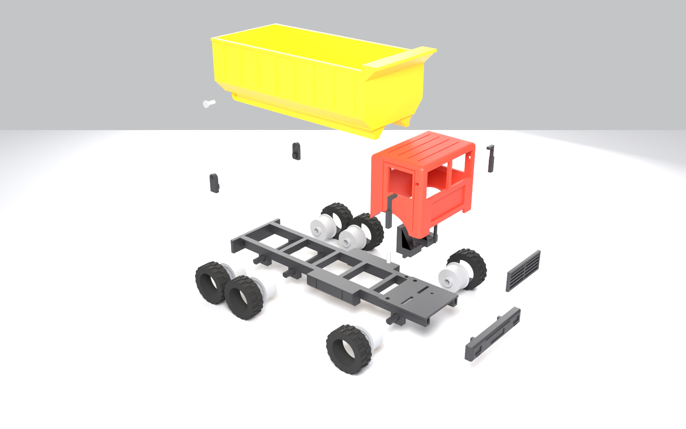
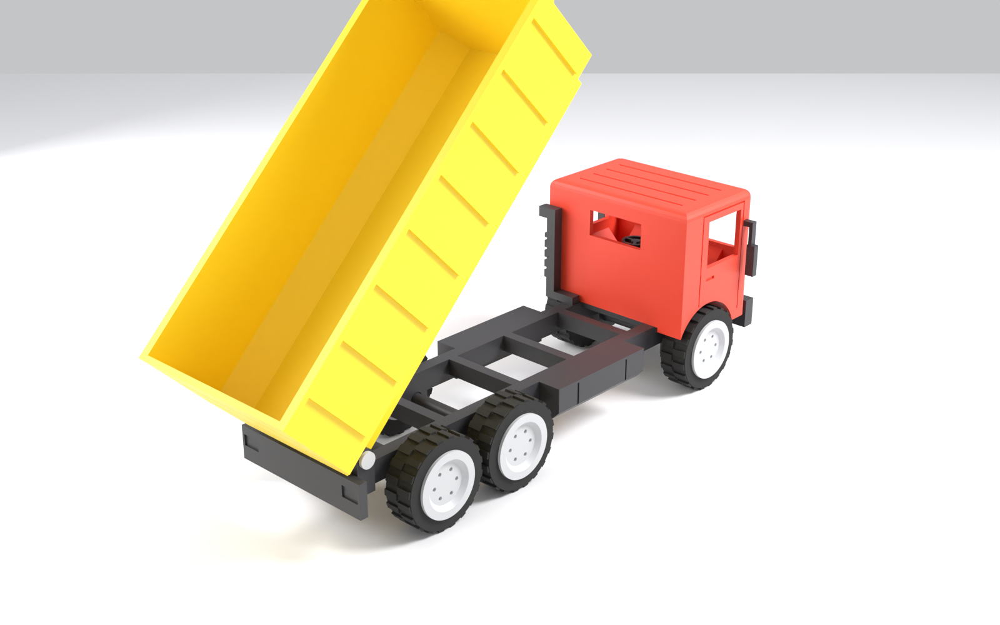
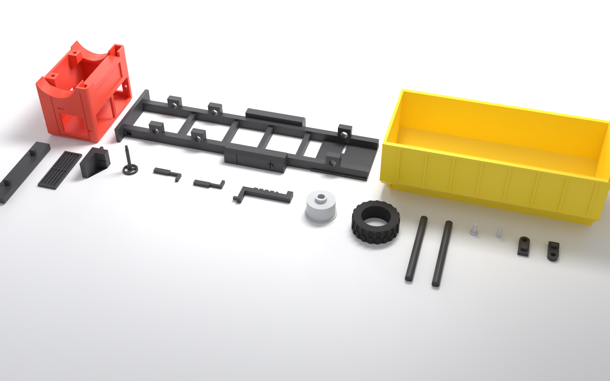

# Oyuncak Damperli Kamyon – 3D Baskıya Hazır Blender Modeli



Parametrik, **Blender Python** ile üretilmiş, gerçek ölçülü (mm) ve FDM 3D yazıcıda
**destek (support) gerektirmeden** basılacak şekilde tasarlanmış 6×4 damperli kamyon.
Damper kasası mafsal pimleri üzerinde **45°+ kalkar**, tekerlekler akslarla birlikte **döner**.

| | |
|---|---|
| Genel ölçü | **200 × 70 × 80 mm** (aynalar dahil genişlik 75 mm) |
| Parça sayısı | 15 parça tipi, toplam **32 adet** baskı |
| Birim | 1 Blender birimi = 1 mm (STL'ler mm) |
| Doğrulama | `validate.py` → **TÜM TESTLER GEÇTİ** (bkz. `validation_report.txt`) |

## Dosyalar

| Dosya | Açıklama |
|---|---|
| `dump_truck.py` | Tüm geometriyi üreten parametrik Blender betiği (ölçüler/toleranslar en üstte) |
| `dump_truck.blend` | Blender dosyası: `Assembly` (montajlı) ve `Print_Plate` (baskı yönünde dizili) koleksiyonları |
| `stl/` | Baskı yönüne çevrilmiş, tablaya oturtulmuş (z=0) STL dosyaları |
| `validate.py` | Manifold / katlanma / çakışma / damper devirme / sarkma testleri |
| `fit_check.py` | Parça parça geçme ölçümü, montaj sırası simülasyonu, test numuneleri (`stl/fit_test/`) |
| `render.py` | Önizleme görselleri (`renders/`) |
| `parts_report.txt`, `validation_report.txt`, `fit_report.txt` | Ölçü ve test raporları |

## Parça listesi ve baskı ayarları

| # | STL | Adet | Renk / Malzeme | Baskı yönü | Notlar |
|---|---|---|---|---|---|
| 1 | `01_cabin.stl` | 1 | Kırmızı PLA | Tavan tablada (ters) | Alt açık kabuk; camlar ortadan bölünmüş → köprü ≤ 26 mm |
| 2 | `02_chassis.stl` | 1 | Siyah PLA | Üst yüzey tablada (ters) | 194 mm uzun → en az 200×200 tabla (180 mm tablada çapraz) |
| 3 | `03_dump_bed.stl` | 1 | Sarı PLA | Taban aşağı | Alt kirişler 45° pahlı; kirişler arası 15 mm köprü |
| 4 | `04_front_bumper.stl` | 1 | Siyah PLA | Ön yüz tablada | Arka tırnaklar yukarı bakar |
| 5 | `05_grille.stl` | 1 | Siyah/Gri PLA | Arka yüz tablada | Kabin önündeki 1.2 mm cebe yapıştırılır |
| 6 | `06_seat_x2.stl` | **2** | Siyah PLA | Yan yatık | Alt tırnak şasi yuvasına geçer |
| 7 | `07_steering_wheel.stl` | 1 | Siyah PLA | Simit tablada, mil yukarı | 0.12 mm katman önerilir |
| 8 | `08_mirror_left/right.stl` | 1+1 | Siyah PLA | Yatık | Kare tırnak kabindeki deliğe geçer |
| 9 | `09_exhaust_pipe.stl` | 1 | Siyah PLA | Yatık | Ayağı şasi rayındaki kare yuvaya geçer (sağ taraf) |
| 10 | `10_wheel_rim_x6.stl` | **6** | Gri PLA | Dış yüz tablada | D-kesitli aks deliği (sıkı geçme) |
| 11 | `11_tire_x6_TPU.stl` | **6** | Siyah **TPU 95A** | Yan yatık | İç çap 20.0 = jant çapı (esneyerek oturur) |
| 12 | `12_front_axle.stl` | 1 | Siyah PLA | Düz yüz tablada | Ø5 mm, alt düzlük 0.4 mm |
| 13 | `13_rear_axle_x2.stl` | **2** | Siyah PLA | Düz yüz tablada | Ön aks ile aynı ölçü |
| 14a | `14a_pin_hinge_x2.stl` | **2** | Gri PLA | Baş tablada | Damper mafsal pimi Ø3 × 7.6 + baş |
| 14b | `14b_pin_cabin_x2.stl` | **2** | Gri PLA | Dik | Kabin konum pimi Ø3 × 9 |
| 15 | `15_bed_hinge_left/right.stl` | 1+1 | Siyah PLA | Dış yüz tablada | Tırnak şasi rayındaki yuvaya geçer |

**Genel slicer ayarları (PLA):** 0.4 mm nozül · 0.16–0.20 mm katman · 3 duvar (perimeter) ·
%20 dolgu (gyroid) · **destek: KAPALI** · köprü fanı %100 · küçük parçalar için 0.12 mm katman.
Şasi ve kasa için brim 3–5 mm önerilir.

**TPU lastik:** 0.2 mm katman, 20–25 mm/s, retraksiyon düşük, %15 dolgu.
TPU yoksa lastikleri PLA ile basın; `dump_truck.py` içinde `make_tire()` → `bore`
yarıçapını `RIM_R + 0.1` yapıp yeniden üretin ve lastiği janta yapıştırın.

## Tasarım toleransları

| Bağlantı | Ölçü | Tip |
|---|---|---|
| Tırnak / yuva (tampon, menteşe, koltuk, ayna, egzoz) | +0.15 mm her yüzde | Sıkı-kayar geçme (+ isteğe bağlı yapıştırıcı) |
| Aks ↔ şasi yatağı | Ø5.0 ↔ Ø5.6 | Serbest dönme |
| Aks ↔ jant göbeği | Ø5.0 D ↔ Ø5.1 D | Pres geçme (jant aksla döner) |
| Mafsal pimi ↔ menteşe / kasa | Ø3.0 ↔ Ø3.3 / Ø3.1 | Kasa pim üzerinde döner |
| Kabin pimi ↔ delikler | Ø3.0 ↔ Ø3.2 | Konumlama |
| Jant göbeği ↔ şasi yatağı | 0.3 mm boşluk | Tekerlek yanal oynamaz |
| Kasa altı ↔ menteşe | 0.6 mm boşluk | Devirme serbest |

Yazıcınız delikleri dar basıyorsa `dump_truck.py` içindeki `FIT` değerini 0.2–0.25 yapıp betiği yeniden çalıştırın.

## Montaj sırası



1. **Akslar:** 3 aksı (1 ön, 2 arka) şasinin alt yatak bloklarından geçirin.
2. **Tekerlekler:** Lastikleri (TPU) jantlara geçirin; jantları D-kesit düzlüğü aksın düz yüzüyle
   hizalayıp aks uçlarına bastırın (6 adet). Tekerlekler serbestçe dönmelidir.
3. **Kabin içi:** Koltukları (2) ve direksiyonu şasi platformundaki yuvalara takın.
   Izgarayı kabin önündeki cebe yapıştırın.
4. **Kabin:** 2 kabin pimini şasi deliklerine takın, kabini üstten pimlere oturtun.
   Tamponu tırnaklarıyla şasi rayı uçlarına, aynaları kabin yanındaki kare deliklere,
   egzozu sağ ray üzerindeki kare yuvaya takın.
5. **Damper:** İki menteşe braketini şasinin arka dış yüzündeki yuvalara takın (gerekirse yapıştırın).
   Kasayı yerleştirip mafsal pimlerini dışarıdan menteşe → kasa kirişine geçirin.
6. **Bitti!** Kasa arkadan ~45–55° kalkar.



## Doğrulama (validate.py)

- **Manifold:** 18 STL dosyasının hepsi su geçirmez, normaller tutarlı, hacim pozitif.
- **Yüzey katlanması:** Hiçbir parçada üst üste binen / katlanmış eşdüzlemsel üçgen yok.
- **Montaj çakışması:** 32 parça arasında en büyük kesişim **0.0000 mm³**.
- **Damper devirme:** 0°–50° arası kasa; şasi, kabin, tekerlekler ve menteşelerle **çakışmıyor**.
- **Ölçü:** 200.0 × 70.0 × 80.0 mm (aynalar hariç).
- **Sarkma:** Parçalarda 45°'den dik serbest sarkma yok; kalan yatay köprüler kısa
  (kabin camları ≤ 25.5 mm, kasa altı 15 mm, jant çanağı Ø14 mm) – destek gerektirmez.

## Parça parça geçme doğrulaması (fit_check.py)

Her birleşim ayrı ayrı ölçülür (rapor: `fit_report.txt`):

| Birleşim | Hedef boşluk | Ölçülen | Geçme boyu | Sonuç |
|---|---|---|---|---|
| Ön/arka aks → şasi yatağı (döner) | 0.30 | 0.30 | 5.7 mm | ✅ |
| Jant → aks, D-delik (pres) | 0.05 | 0.05 | 8.7 mm | ✅ |
| Lastik (TPU) → jant | 0.00 | 0.00 | 11.0 mm | ✅ |
| Kabin pimi → şasi / kabin bloğu | 0.10 | 0.10 | 4.9 / 3.9 mm | ✅ |
| Koltuk tırnağı → platform yuvası | 0.15 | 0.15 | 2.4 mm | ✅ |
| Direksiyon mili → platform deliği | 0.15 | 0.15 | 2.2 mm | ✅ |
| Izgara → kabin cebi | 0.15 | 0.15 | 1.2 mm | ✅ |
| Ayna tırnağı → kabin deliği | 0.15 | 0.15 | 2.2 mm | ✅ |
| Tampon tırnağı → ray yuvası | 0.15 | 0.15 | 4.4 mm | ✅ |
| Egzoz tırnağı → ray yuvası | 0.15 | 0.15 | 3.1 mm | ✅ |
| Menteşe tırnağı → ray yuvası | 0.15 | 0.15 | 1.7 mm | ✅ |
| Mafsal pimi → menteşe (serbest) / kasa (sıkı) | 0.15 / 0.05 | 0.15 / 0.05 | 2.9 / 3.6 mm | ✅ |

Fonksiyonel boşluklar: kasa ve kabin şasiye tam oturuyor (0.00), tekerlek yan boşluğu 0.30,
kasa–menteşe devirme boşluğu 0.60, lastik–gövde en yakın mesafe 1.26 mm.

**Montaj sırası simülasyonu:** Her parça gerçek takılma yönünde 0.25 mm adımlarla kaydırılıp
önceden takılmış parçalarla çarpışma kontrol edildi – 31 adımın tamamı geçti
(akslar → lastik/jant → tekerlekler → koltuk/direksiyon/pim → ızgara → kabin → ayna/tampon/egzoz →
menteşe → kasa → mafsal pimleri).

### Önce test baskısı (önerilir)

`stl/fit_test/` klasöründe gerçek parçalardan kesilmiş küçük test numuneleri var:

| Dosya | Test ettiği |
|---|---|
| `T1_chassis_rear_crop.stl` | Arka aks yatağı, menteşe yuvası |
| `T2_chassis_front_crop.stl` | Ön aks yatağı, kabin pimi, koltuk/direksiyon yuvası, tampon ve egzoz yuvası |
| `T3_bed_pivot_crop.stl` | Kasa mafsal deliği |

Bunlarla birlikte 1 menteşe, 1 mafsal pimi, 1 aks, 1 jant, 1 lastik, 1 kabin pimi, 1 koltuk,
direksiyon, tampon ve egzozu basın (~1–1.5 saat). Hepsi rahat geçiyorsa tüm modeli basın;
sıkıysa `FIT` değerini 0.2–0.25 yapıp yeniden üretin.

## Yeniden üretme

```bash
pip install bpy trimesh manifold3d   # python dump_truck.py -- .  ile de çalışır
# Blender 4.2+ kurulu ise:
blender --background --python dump_truck.py -- .
python validate.py .
python fit_check.py .
blender --background dump_truck.blend --python render.py -- .
```


